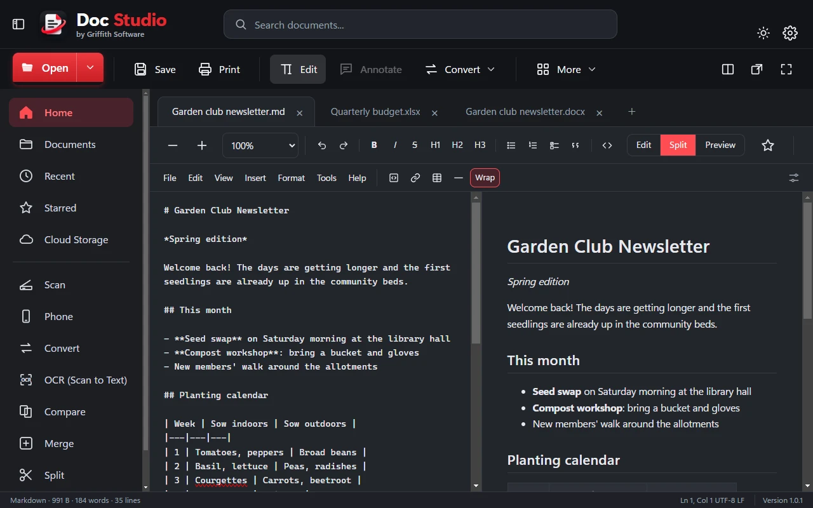

# Doc Studio

Doc Studio by Griffith Software is a free Windows program for opening, editing, creating and converting documents,
spreadsheets, presentations, PDFs and Markdown files, keeping each file's own formatting. It works on your PC: your
documents are not uploaded anywhere.



## Download

Download `DocStudio-Setup-1.0.1.exe` from the [latest release](https://github.com/Griffith-Software/Doc-Studio/releases/latest).

**Requirements:** Windows 10 (22H2) or Windows 11, 64-bit (x64). Nothing else to install.

### Check the download

The release page lists the SHA-256 of the installer. In PowerShell, in the folder you downloaded it to:

```powershell
Get-FileHash .\DocStudio-Setup-1.0.1.exe -Algorithm SHA256
```

The value it prints must match the one on the release page.

### Windows SmartScreen

Windows may show "Windows protected your PC" when you first run a new release, because Windows has not yet seen
enough downloads of it. Check that the SHA-256 shown on the release page matches your file, then choose More info,
then Run anyway. This release is not code-signed.

## Install and uninstall

- **Install:** run the installer. It installs for your Windows user only (no administrator rights), in
  `%LOCALAPPDATA%\Programs\Doc Studio`, shows the license, and adds a Start menu entry. A desktop shortcut is offered
  on the last page (unticked).
- **Update:** run the newer installer. It replaces the program in the same folder and keeps your settings and data.
- **Uninstall:** Windows Settings > Apps > Installed apps > Doc Studio > Uninstall. It asks whether to also delete
  your Doc Studio data (settings, recent files list, version history, backups); the answer is No unless you choose
  Yes. Your documents themselves are never touched.

### Silent install and uninstall (for administrators)

```powershell
.\DocStudio-Setup-1.0.1.exe /S
& "$env:LOCALAPPDATA\Programs\Doc Studio\Uninstall Doc Studio.exe" /currentuser /S
```

A silent uninstall keeps your Doc Studio data. Add `--delete-app-data` to delete it as well.

## What it does

- **Opens and edits** .docx, .doc, .rtf and .odt documents; .xlsx, .xls, .xlsb, .ods and .csv spreadsheets (with
  formulas and charts); .pptx, .ppt and .odp presentations; PDFs (annotate, fill forms, sign, rearrange pages);
  Markdown (edit, split view and preview); text, web pages, EPUB books, JSON, XML and pictures.
- **Creates** new Markdown, documents, spreadsheets, presentations, PDFs and more, from Home or the + tab.
- **Tools:** Convert, OCR (scan to text, using the text recognition built into Windows), Compare, Merge into one PDF,
  Split a PDF, Compress, Scan (from a scanner connected to your PC), and Phone (send photos and files between your
  phone and your PC over your home Wi-Fi with a QR code; no app needed on the phone).
- **Picture editor:** crop, rotate, adjust, filters, draw, text, resize, and remove background (worked out on your
  PC), then save as PNG, JPEG, WebP or BMP.
- **Keeps your work safe:** a copy of every saved version (newest 40 per file), a backup before a file is first
  overwritten, and recovery of unsaved work after a crash or power cut.
- **Default apps:** Settings > Default apps helps you make Doc Studio the program that opens each file type, and files
  it opens show an icon for their type. Right-click a file for "Open with Doc Studio" (Windows 11: Show more options).
- **AI assistants (optional, off until you switch them on):** Claude Code, Claude Desktop, Gemini CLI and OpenAI
  Codex can use Doc Studio to read, create and convert documents. They create new files only and never delete
  anything. Set up in Settings > AI assistants.

When Microsoft Word, Excel or PowerPoint, or LibreOffice, is installed, Doc Studio uses it in the background for the
closest results with older formats (.doc, .xls, .ppt) and some conversions. Everything else works without them.

## Privacy

Doc Studio has no account, no ads, no analytics and no tracking, and it does not check for updates. It only uses
the internet when you ask it to:

- **Dictionary** (Tools > Dictionary) sends the word you look up to dictionaryapi.dev.
- **Links** you click in a document open in your web browser.
- **Phone** runs a small web page on your PC for your phone, answering only devices on your local network that
  have the code from the QR code, while the Phone window is open.
- **AI assistants**, when you switch them on, work through a connection on your PC only. What an assistant reads is
  then handled by that assistant's own service.

Your settings, version history, backups and unsaved-work copies stay in `%APPDATA%\Doc Studio`. The full privacy
policy is on the [Doc Studio page](https://griffith.software/DocStudio.html).

## Support

Doc Studio is free and provided as is, with no promise of support, fixes or new features. Found a problem or want a
feature? Use the [feedback page](https://griffith.software/feedback.html). See the
[terms](https://griffith.software/terms.html).

Doc Studio is an independent project. It is not made by, endorsed by, or affiliated with Microsoft, Google,
Anthropic, OpenAI or The Document Foundation (LibreOffice), and those names belong to their owners. They are
mentioned only to say which formats and programs Doc Studio works with.

## License

Doc Studio is source-available under the Apache License 2.0 with the Commons Clause License Condition v1.0: you may
use, modify and share it free of charge, but you may not sell it. Copyright (c) 2026 Richard Griffith (d/b/a Griffith
Software). See [LICENSE](LICENSE) and [NOTICE](NOTICE); "Doc Studio" and "Griffith Software" are trademarks, and the
license grants no rights to use them.

Third-party components are listed in [THIRD_PARTY_NOTICES.md](THIRD_PARTY_NOTICES.md) under their own licenses. For
building and testing Doc Studio, see [DEVELOPMENT.md](DEVELOPMENT.md).
